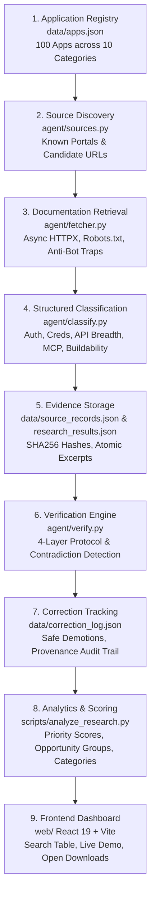

# System Architecture & Pipeline Data Flow

**Project**: Composio Integration Research Agent — 100-Application Automated Assessment  
**System Version**: 1.0.0  
**Language & Frameworks**: Python 3.11+, asyncio, httpx, React 19, Vite, Tailwind CSS  
**Architectural Style**: Asynchronous Pipeline with Decoupled Static Data Contracts

---

## 1. High-Level Architecture Diagram



---

## 2. End-to-End Pipeline Stage Specifications

### Stage 1: Application Registry (`data/apps.json`)
- **Purpose**: Establishes the immutable scope of investigation.
- **Implementation**: Curates exactly 100 applications distributed evenly across 10 categories (10 applications per category).
- **Enforcement**: IDs are strictly sequential from 1 to 100. Every application references a valid category (`CRM and Sales`, `Support and Helpdesk`, `Communications and Messaging`, `Marketing, Ads, Email and Social`, `Ecommerce`, `Data, SEO and Scraping`, `Developer, Infra and Data Platforms`, `Productivity and Project Management`, `Finance and Fintech`, `AI, Research and Media-Native`).
- **Validation**: Enforced via `scripts/validate_dataset.py` (9 checks).

### Stage 2: Source Discovery (`agent/sources.py`)
- **Purpose**: Maps application targets to candidate documentation URLs without crawling arbitrary non-developer pages.
- **Implementation**: 
  - `KNOWN_DOCS_MAP`: Curated canonical documentation URLs for high-priority platforms.
  - `generate_candidate_urls(app_name, website_url)`: Generates structured candidate URLs across standard developer patterns (`docs.{domain}`, `developer.{domain}`, `{domain}/api`, `{domain}/docs`).
  - `get_mcp_search_urls(app_name)`: Queries GitHub and official registries for Model Context Protocol servers (`@modelcontextprotocol/server-{app}`).

### Stage 3: Documentation Retrieval (`agent/fetcher.py`)
- **Purpose**: Fetches real web content defensively and filters out non-documentation payloads.
- **Implementation**:
  - `AsyncFetcher`: Built on `httpx.AsyncClient` with bounded timeouts (8.0s), 1.0s inter-request domain rate limits, and custom User-Agent.
  - `RobotsParser`: Parses and respects `robots.txt` disallows for targeted domains.
  - `check_content_validity(html, url)`: Defends against anti-bot traps:
    - Rejects `< 40` character empty shells.
    - Detects unrendered client-side Single-Page Apps (`<div id="root"></div>`, "You need to enable JavaScript").
    - Flags Cloudflare Turnstile challenge walls ("Attention Required! | Cloudflare").
    - Flags private login walls ("Sign in to continue to Developer Portal").
  - Content Hashing: Computes SHA-256 prefixes to ensure exact content traceability.

### Stage 4: Structured Classification Engine (`agent/classify.py`)
- **Purpose**: Transforms raw HTML text into standardized, typed technical classifications.
- **Implementation**:
  - **Authentication Rubric**: Classifies across 10 types (`OAuth2`, `API Key`, `Bearer Token`, `PAT`, `Basic Auth`, `Service Account`, `JWT`, `HMAC`, `Session Based`, `Unknown`) via semantic regex patterns and keyword context.
  - **Credential Accessibility Rubric**: Scores onboarding friction into 10 tiers (`free_self_serve`, `trial_self_serve`, `paid_self_serve`, `contact_sales`, `enterprise_only`, etc.).
  - **API Breadth Scoring**: Evaluates entity types, CRUD operations, and advanced features into 5 tiers (`extensive`, `broad`, `moderate`, `narrow`, `unknown`).
  - **MCP Availability**: Classifies into `official_mcp` (vendor verified repo), `community_mcp`, `mcp_unverified`, or `unknown`.
  - **Quality Gates Evaluation**: Enforces 5 formal gates (`valid_identity`, `has_evidence_links`, `auth_claims_supported`, `credential_claims_supported`, `official_source_present`) yielding statuses `passed`, `partial`, `needs_review`, `blocked`.

### Stage 5: Evidence Storage (`data/source_records.json` & `data/research_results.json`)
- **Purpose**: Persists atomic claim evidence and immutable baseline snapshots.
- **Implementation**:
  - `data/source_records.json`: Stores all 175 candidate source records with HTTP status, fetch duration, content length, and SHA-256 hash.
  - `data/batch1_first_pass.json` & `data/batch2_first_pass.json`: Immutable snapshots of first-pass classifications prior to verification.
  - `data/research_results.json`: Complete 100-application dataset with bound `claim_evidence` citations (claim field, value, source URL, excerpt `< 280` chars, confidence).

### Stage 6: Four-Layer Verification Engine (`agent/verify.py`)
- **Purpose**: Audits findings, detects contradictions, and builds human review queues.
- **Implementation**:
  - **Layer 1: Structural Validation**: Confirms schema adherence, valid enums, and required fields.
  - **Layer 2: Evidence Grounding**: Validates that cited URLs returned HTTP 200 and that excerpts contain semantic keywords.
  - **Layer 3: Contradiction Detection**: Detects discrepancies (e.g. documentation mentions API tokens, but initial extraction returned empty auth).
  - **Layer 4: Human Review Flagging**: Generates `data/human_audit_queue.json` (44 applications) and stratified audit sample `data/audit_sample.json` (20 applications, seed `20261123`).

### Stage 7: Correction Tracking (`data/correction_log.json`)
- **Purpose**: Documents automated quality gate alignments with complete provenance.
- **Implementation**:
  - Logs safe automated demotions (e.g. BigCommerce, Apify, Supabase demoted from `passed` to `partial` due to unextracted auth terms).
  - Stores `original_value`, `corrected_value`, `reason_for_correction`, timestamp, and human approval requirement flag (`false`).

### Stage 8: Analytics & Opportunity Scoring (`scripts/analyze_research.py`)
- **Purpose**: Computes strategic metrics, category comparative matrix, and priority rankings.
- **Implementation**:
  - **Priority Scoring Heuristic (0–100)**: Evaluates Credential Access (30%), API Capability (25%), Auth Complexity (15%), MCP Availability (10%), Doc Quality (10%), and Blockers (10%).
  - **Opportunity Grouping**: Partitions all 100 applications into 5 mutually exclusive groups (Group A: Quick Wins, Group B: Conditional, Group C: Outreach Required, Group D: Further Investigation, Group E: No Confirmed Cloud Path).
  - Exports `data/category_comparison.json`, `data/integration_priorities.json`, `data/top_opportunities.json`, `data/outreach_candidates.json`.

### Stage 9: Case Study Dashboard (`web/`)
- **Purpose**: Presents findings, interactive tools, and open datasets to reviewers and recruiters.
- **Implementation**:
  - React 19 + Vite 6 + Tailwind CSS single-page application.
  - Decoupled flat JSON data endpoints in `web/public/data/` (`apps.json`, `summary.json`, `categories.json`, `insights.json`, `verification.json`, `opportunities.json`, `demo_run.json`).
  - Searchable 100-app table with active filter chips, column sorting, pagination, and expandable detail drawer.
  - Interactive terminal demonstrating real CLI execution trace for GitHub (App #61).
  - Direct dataset downloads in `web/public/downloads/` (`.json`, `.csv`, audit sample).
  - Standalone HTML human audit interface in `data/audit_interface.html`.

---

## 3. Data Integrity & Schema Contracts

All data structures conform to strict Pydantic models in `agent/models.py` and TypeScript interfaces in `docs/frontend_data_contract.md`.

### Core Entity Relationships:
1. `Application` (1) &harr; (1) `ResearchFinding`
2. `ResearchFinding` (1) &harr; (N) `SourceRecord`
3. `ResearchFinding` (1) &harr; (N) `ClaimEvidence`
4. `ResearchFinding` (1) &harr; (N) `CorrectionRecord`

### Honesty Guarantee:
If human audit fields are blank, `scripts/calculate_accuracy.py` strictly returns:
```json
{
  "accuracy_status": "NOT MEASURED",
  "reason": "Human audit pending — reference judgments not yet recorded."
}
```
No synthetic accuracy percentages or artificial improvements are ever generated.
